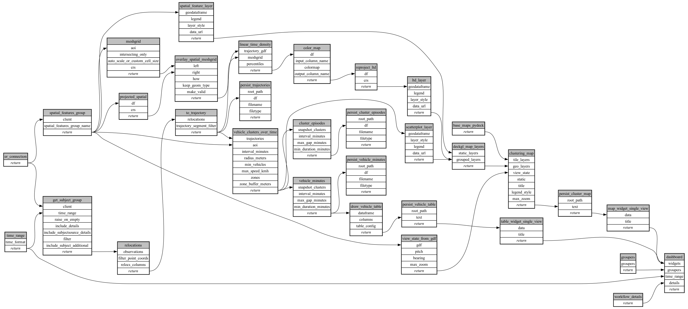

```
# AUTOGENERATED BY ECOSCOPE-WORKFLOWS; see fingerprint in README.md for details

```

```yaml
# fingerprint:
artifacts_sha256_basic: 8a596e6b3be3611387068657e822b28cf7207e0024755c9399e8f26e787f47e2
artifacts_sha256_strict: c9315d8a56abd5bac728902eea5edb580cfba0d44058027f7127e35e6f495ba0
installed_requirements:
- channel: https://repo.prefix.dev/ecoscope-workflows/
  name: ecoscope-platform
  version: {version: ==2.25.3}
- channel: https://repo.prefix.dev/ecoscope-workflows-custom/
  name: ecoscope-workflows-ext-custom
  version: {version: ==0.1.0rc14}
- channel: https://repo.prefix.dev/ecoscope-workflows-custom/
  name: ecoscope-workflows-ext-mep
  version: {version: ==1.0.8}
- channel: https://repo.prefix.dev/ecoscope-workflows-custom/
  name: ecoscope-workflows-ext-ste
  version: {version: ==0.0.0rc1}
- channel: https://repo.prefix.dev/ecoscope-workflows-custom/
  name: ecoscope-workflows-ext-mnc
  version: {version: ==1.0.6}
- channel: conda-forge
  name: pydeck
  version: {version: ==0.9.2}
params_sha256: 89721e1fc6863623947c771da75da92b435f7ec690600168d043091e7d3cd224
spec_sha256: 468e1ea33071cdbfd13b6ada58be43a020901de11e486c0270f2ac3b090c6970

```

# ecoscope-workflows-vehicle-clustering-workflow


